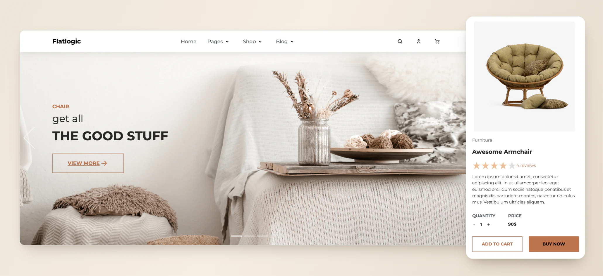

<h1 align="center">Flatlogic Ecommerce React</h1>

<p align="center">A furniture storefront and admin dashboard you can run with your own catalog.<br>Built with Next.js 16, React 19, TypeScript and Bootstrap 5.</p>

<p align="center">
  <a href="https://flatlogic-ecommerce.flatlogic.com/shop"><strong>Explore the live shop</strong></a>
  &nbsp;·&nbsp; <a href="#quick-start">Quick start</a>
  &nbsp;·&nbsp; <a href="https://github.com/flatlogic/ecommerce-backend">Backend</a>
  &nbsp;·&nbsp; <a href="changelog.md">Changelog</a>
</p>

<a href="https://flatlogic-ecommerce.flatlogic.com/">
  <picture>
    <source media="(max-width: 600px)" srcset="docs/images/storefront-mobile.webp">
    
  </picture>
</a>

**Try the storefront.** Browse the [furniture catalog](https://flatlogic-ecommerce.flatlogic.com/shop), open a product to zoom in on its photos, save a favorite or add it to the cart.

**Try the back office.** [Sign in](https://flatlogic-ecommerce.flatlogic.com/login), then open the [admin dashboard](https://flatlogic-ecommerce.flatlogic.com/admin/dashboard) to manage products, orders and blog posts. The public demo restores its sample data at the start of every hour.

## Quick start

First, start the [companion backend and seed its PostgreSQL database](https://github.com/flatlogic/ecommerce-backend#-quick-start). Its local API runs at `http://localhost:8080/api`.

In a second terminal, use [nvm](https://github.com/nvm-sh/nvm) to select the repository’s Node version and start the storefront.

```sh
git clone https://github.com/flatlogic/ecommerce-frontend.git
cd ecommerce-frontend
nvm install
npm ci
cp .env.example .env.local
npm run dev
```

Open [localhost:3000/shop](http://localhost:3000/shop) to see your local catalog. If it is empty, check that the API is running at the address in `.env.local` and has sample products.

## Customize the storefront

| To change | Start here |
| --- | --- |
| Product filters and the catalog grid | [Shop screen](legacy-pages/shop/index.tsx) and [shop styles](legacy-pages/shop/Shop.module.scss) |
| Navigation and footer links | [Header](components/e-commerce/Header/Header.tsx) and [Footer](components/e-commerce/Footer/Footer.tsx) |
| Store colors, typography and spacing | [Sass variables](styles/_variables.scss) |
| Product detail layout | [Product page](legacy-pages/products/%5Bid%5D.tsx) |

## Configuration and checks

<details>
<summary><strong>API addresses and checkout</strong></summary>

The defaults in [`.env.example`](.env.example) connect the frontend to a local API. Set the deployment values before building.

| Variable | Purpose |
| --- | --- |
| `API_BASE_URL` | API address reachable from the Next.js server, including `/api`. |
| `NEXT_PUBLIC_API_BASE_URL` | API address reachable from the shopper’s browser, including `/api`. |
| `NEXT_PUBLIC_APP_URL` | Storefront address used for checkout return links. |

The billing page demonstrates Stripe Checkout with one sample line item. For real orders, configure Stripe on the backend and calculate the total there from the shopper’s cart.

</details>

<details>
<summary><strong>Production build and tests</strong></summary>

| Command | What it does |
| --- | --- |
| `npm run build` | Build the production frontend. |
| `npm start` | Serve the production build. |
| `npm run verify` | Type-check, lint, run unit tests with coverage and build. |
| `npm run test:e2e` | Run desktop and mobile browser tests. |
| `npm run test:visual` | Compare screenshots against the saved visual baselines. |

Install the test browsers once with `npx playwright install chromium webkit`. The visual baselines were captured on macOS. Pinned tool versions are in [`.nvmrc`](.nvmrc) and [`package.json`](package.json).

</details>

## License and support

[MIT license](LICENSE) · [Latest release](https://github.com/flatlogic/ecommerce-frontend/releases/latest) · [Report a bug](https://github.com/flatlogic/ecommerce-frontend/issues) · [Flatlogic forum](https://flatlogic.com/forum)
